# The T-symbol from the Stockholm Metro

## Introduction

On a recent visit to NYC I was struck by how great the city is at promoting itself. Obviously, there are the typical tourist gift shops selling more or less tacky souvenirs. The original "I <3 NY" t-shirt is a classic example that now has been copied and modified into oblivion. However, there are business that make a living out of selling NYC-related products and that have a fresher take on souvenirs; things that you'd actually want to buy and use as a local to show pride for your city. Not just a fridge magnet.

Stockholm, on the other hand, has some ways to go I think. The city should be able to conjure up some more interesting, iconic symbols that could be used in a similar way. After all, Stockholm is large enough, has a rich history and is home to a lot of creative individuals. 

So, I started thinking about what could be a good symbol with accompanying product to represent Stockholm. Something other than a t-shirt with the moose traffic warning sign. Quite quickly the obvious choice came to mind: the T-symbol from the Stockholm Metro and to produce a lamp in the shape of its typical street lamp seen at the entrances to the stations.

## Replication

The T-symbol sign is a simple but, as we will study quickly, functional design. It's a deep blue, blocky "T" on a circular, white background. Most people would from memory say the sign is spherical or round. This is true, but not the whole story. Straight on it's circular but from above/below (i.e., not your typical viewing angle) it's rather triangular. 

Compare the Google search results for "stockholms tunnelbana t symbol skylt" and the photo I took from under the sign at Medborgarplatsen station:

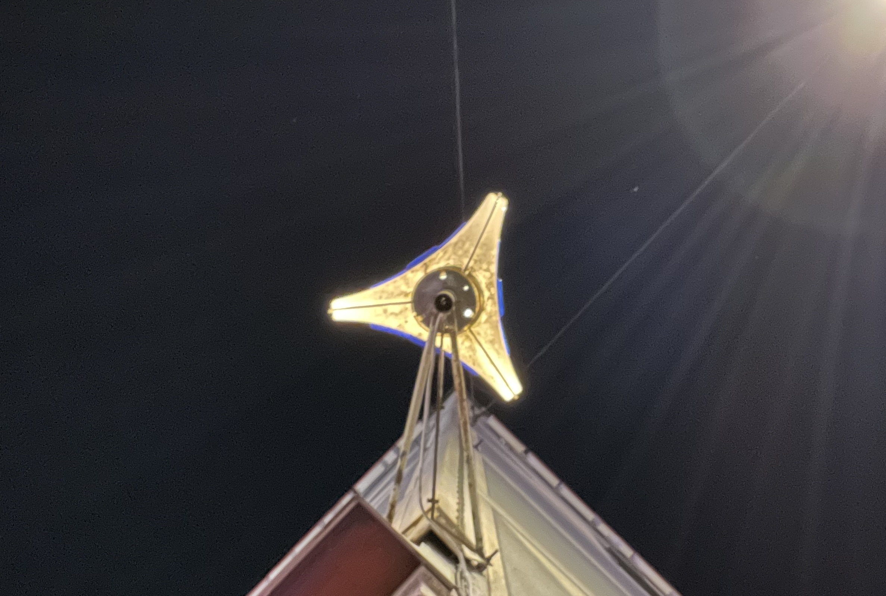

### Basic shape

So, let's start by replicating the sign in a 3D model. Using Fusion 360, I started by revolving a half circle with radius `r_sphere` around the vertical axis to create a sphere. I'm using a parametric approach to be able to easily scale it later on. Based on the above photo, I assumed the shape is created by cutting the sphere using three cyindrical cuts. The cuts are placed evenly around the vertical axis (120 degrees apart). The radius of the cuts is defined by that there's 1/48 th of the 

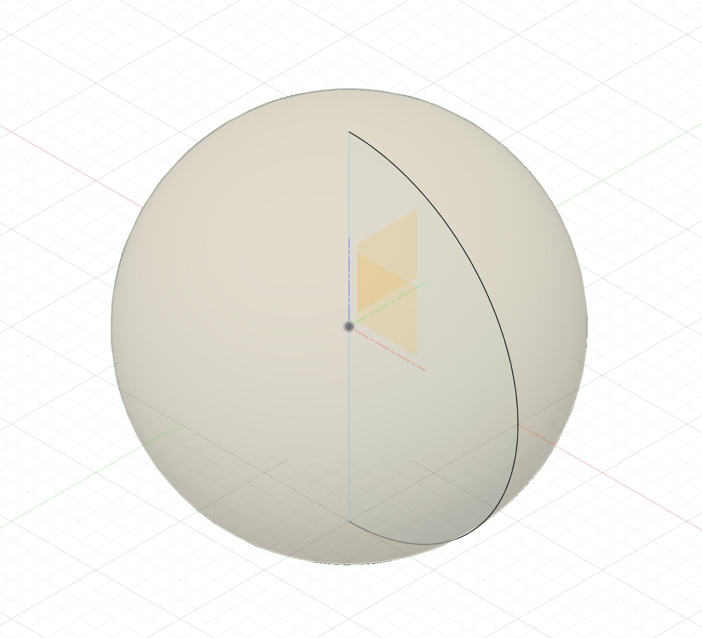
Sphere

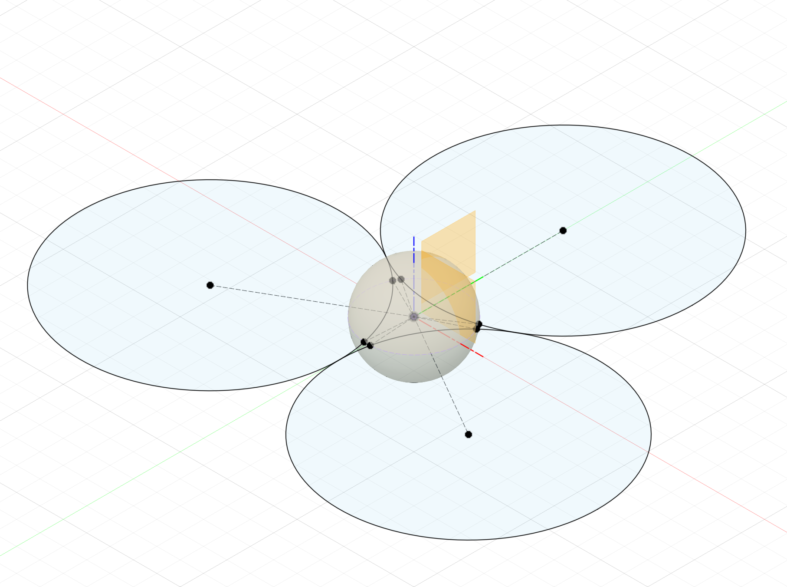
Sketch for the cylindrical cuts

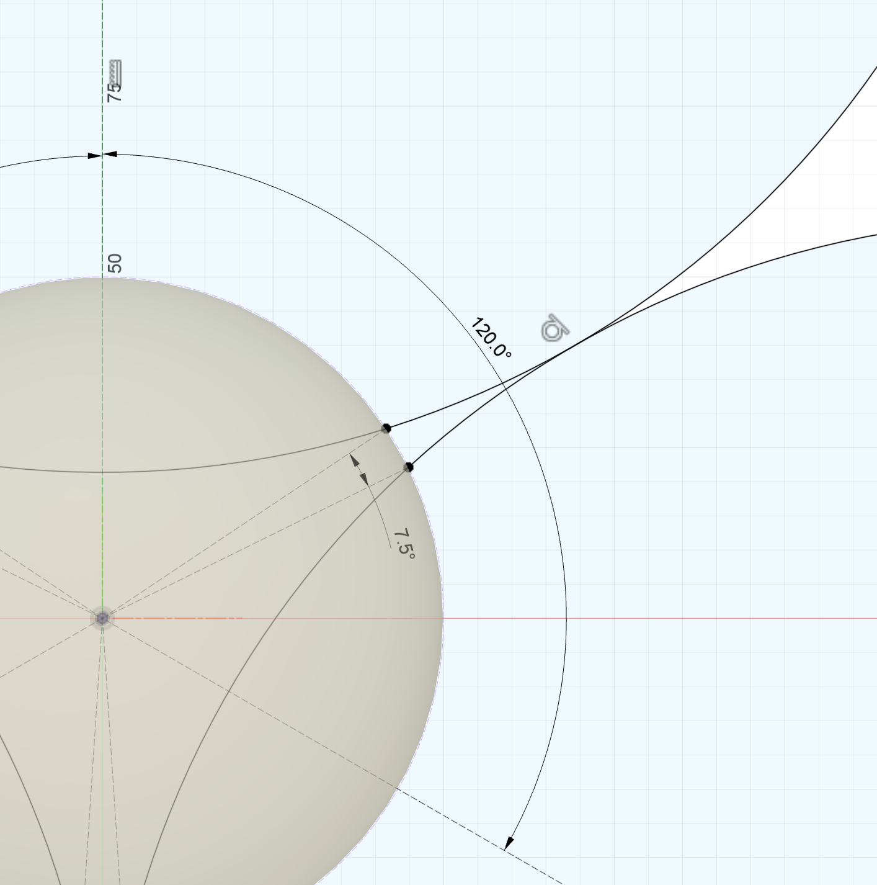
Sketch for the cylindrical cuts (detail)

And yes, it seems to line up well with the photo!

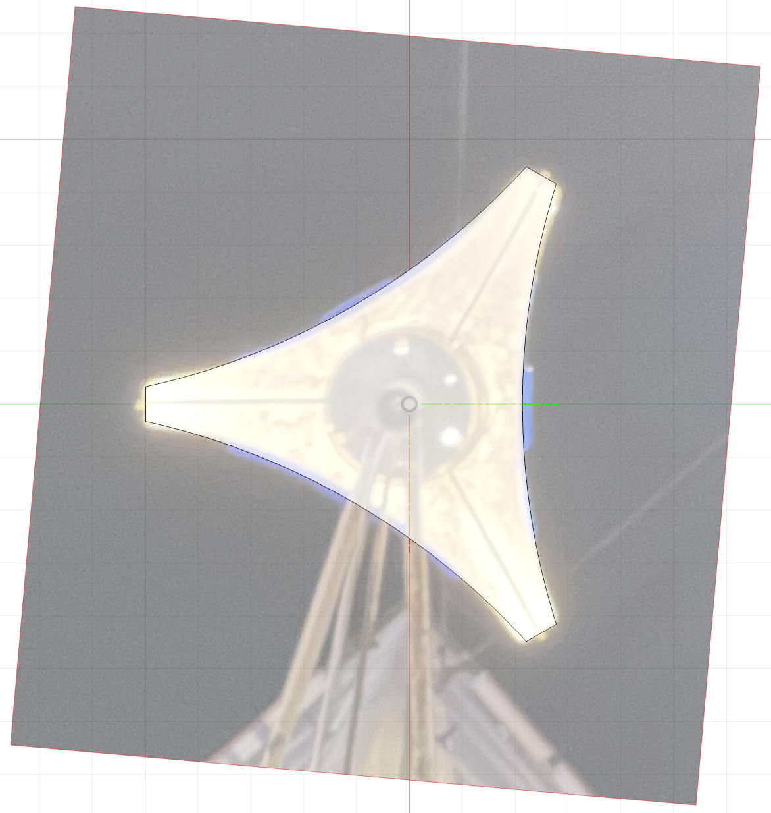

### Perfecting the shape

With the cylinders cut out, the side view of the sign is no longer a perfect circle as can be seen in the image below. Instead, it's now more oval shaped, slightly slimmer around the "equator". Looking at photos from the web, this seems to be the case for the real sign as well. However, let's see if we can create a more circular shape (if that's what we'll want in the end I don't know). We can achieve this by instead of revolving a half circle, we can revolve an conical curve. Below is a comparison between a) a half circle, b) a conical curve with the rho value set to 0.15, and c) a conical curve with the rho value set to 0.2. 

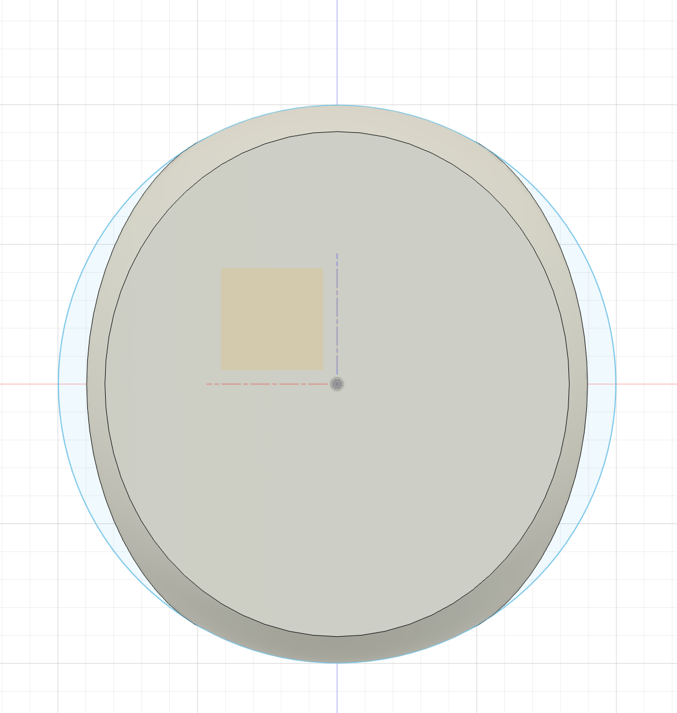
a) Half circle

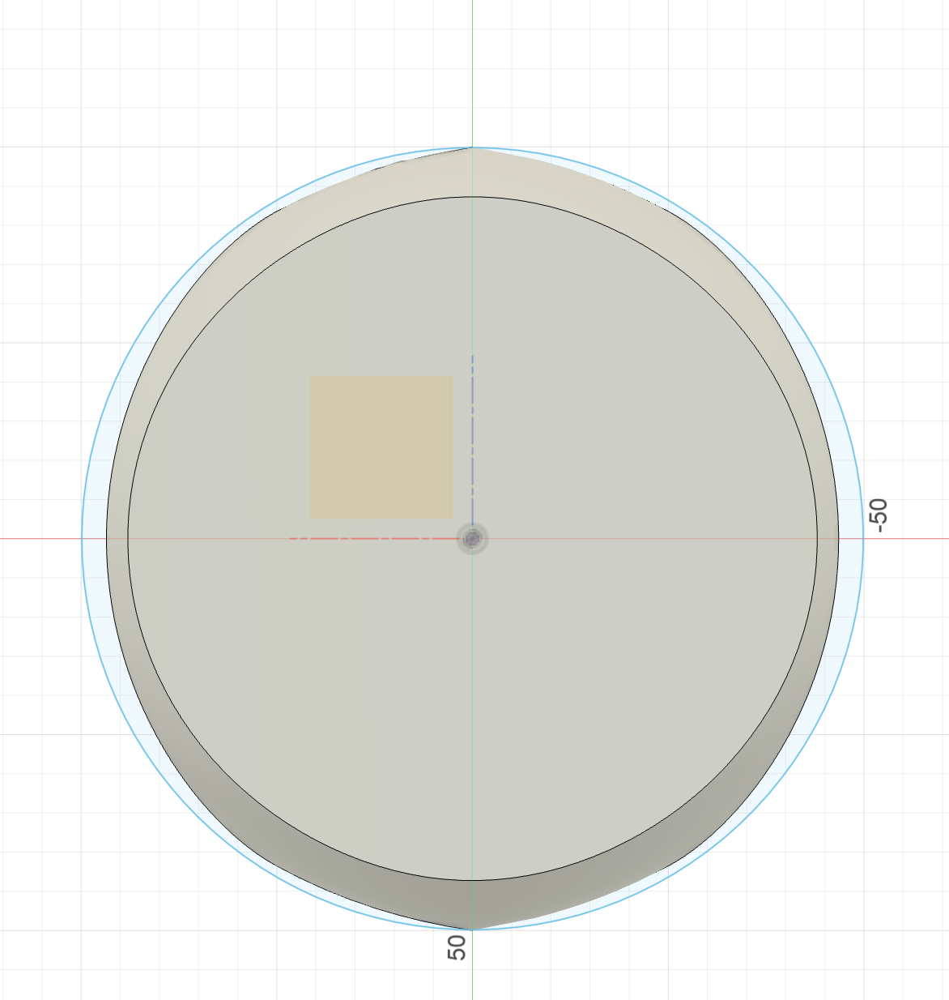
b) Conical curve with rho = 0.15

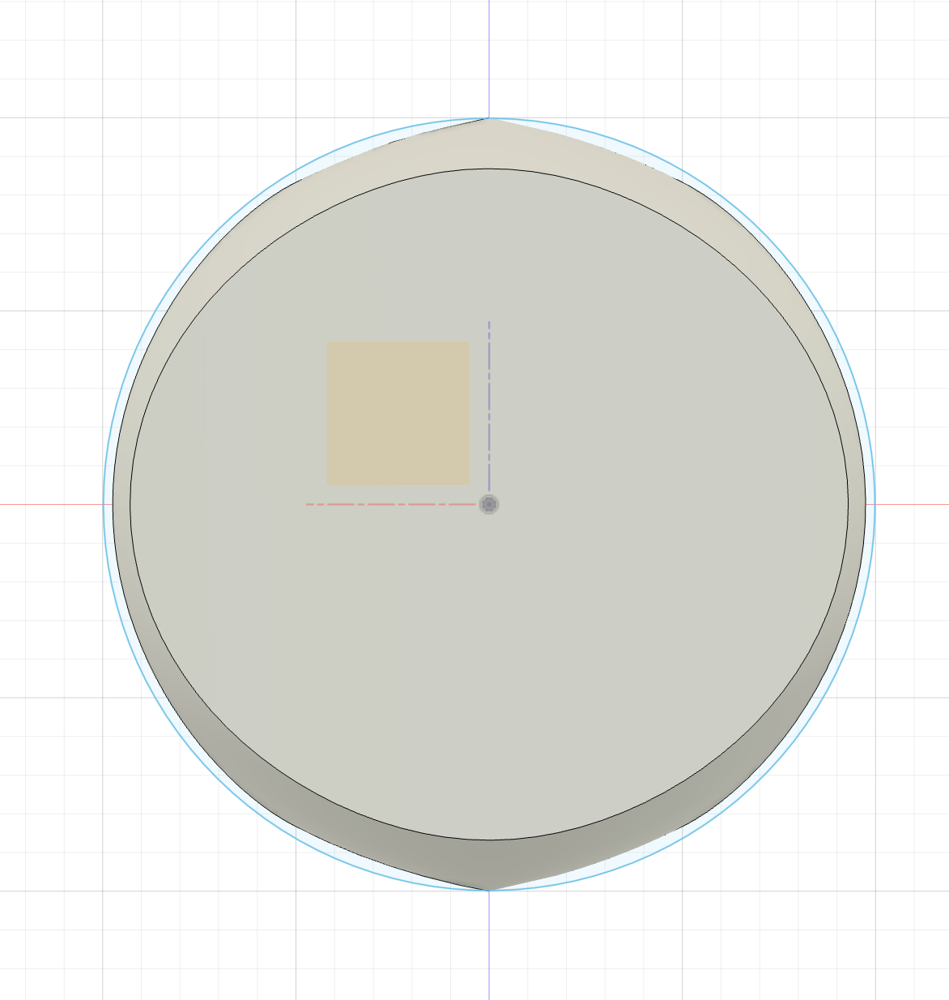
c) Conical curve with rho = 0.2

The conical curve with rho = 0.2 seems to be the best fit to a perfect circle. However, instead a pointy top and bottom is introduced. To make things easier, we'll stick with the half circle for now. We can come back to this later on and use a more complex shape which blends the two.

### The "T"

Now onto the letter "T" which arguably is the main feature of the sign. To capture the shape, I again used a photo to trace the outline of the letter. Again, I used a parametric approach and set the measurements as a fraction of the sphere's radius. For example, the total width of the "T" is `1.15*r_sphere` and the width of the bars are `0.35*r_sphere`.

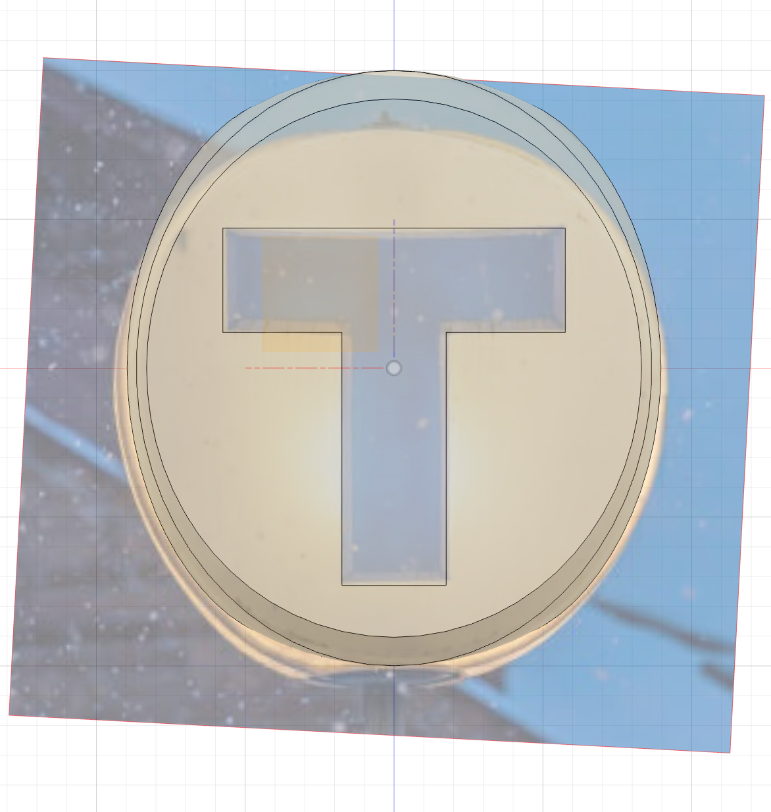

With the sketch complete, I extruded it to `0.05*r_sphere` past the surface of the cut sphere to make it stand out which it does on some, if not most, of the real signs. Some signs have it flush with the surface, and painted/printed on, but I think the extruded version looks a lot better. The T's also have a slight bevel to them, which I added by adding a "Chamfer" feature to the extrusion. 

The final step is to copy the T to the other two sides using the "Circular Pattern" feature. Then I added materials to the bodies to make it look nice, now it looks like this:

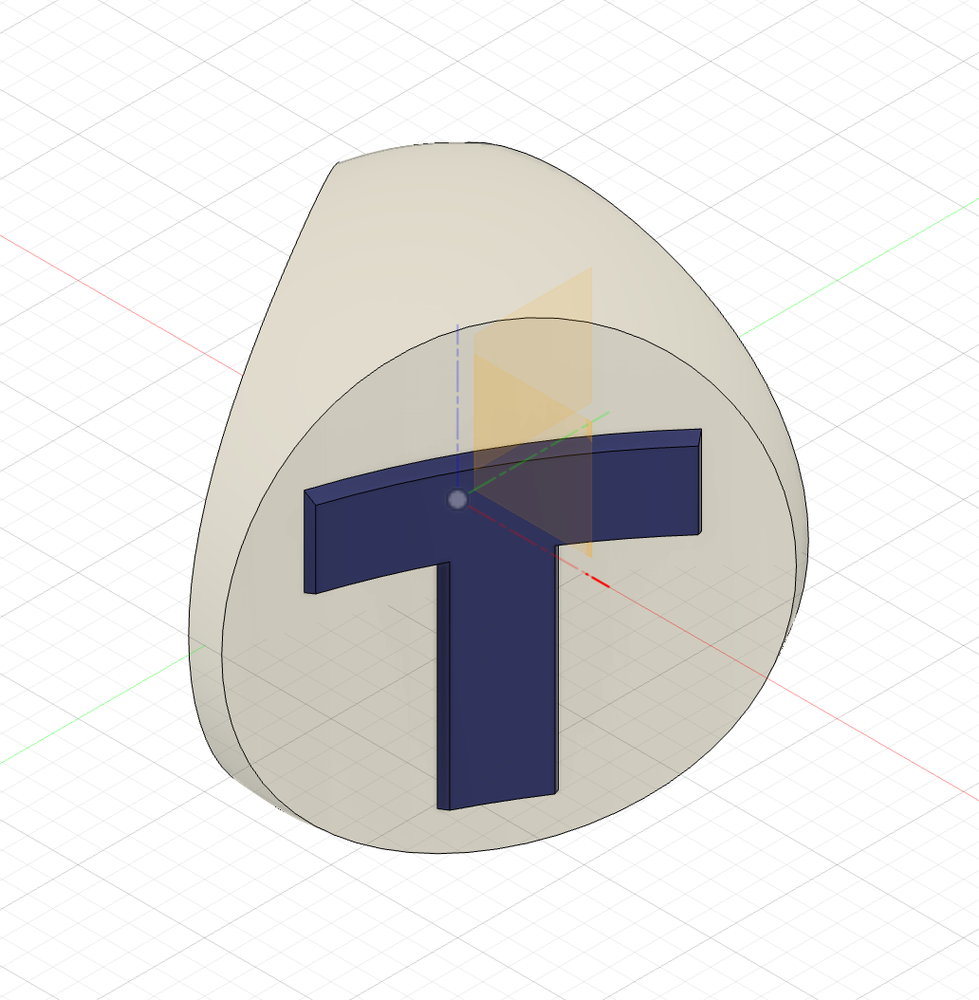

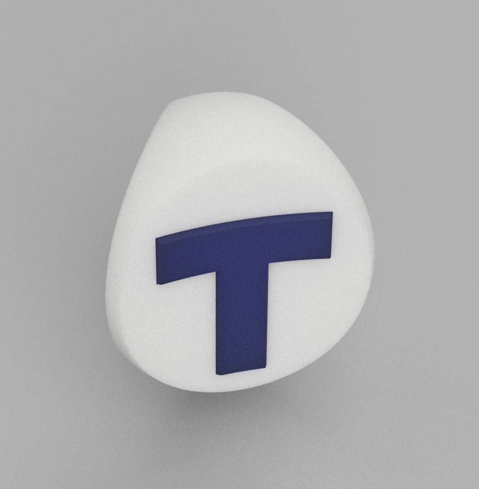

## Design for Manufacturing

Now that we have a 3D model of the sign, we need to think about how to manufacture it. I've already decided that we'll be 3D printing it, but how? As a single piece is not an option. Since it's symmetrical across its three sides, we can split the white ball into three parts. The T's can be printed separately and inserted into the holes in the white ball.

